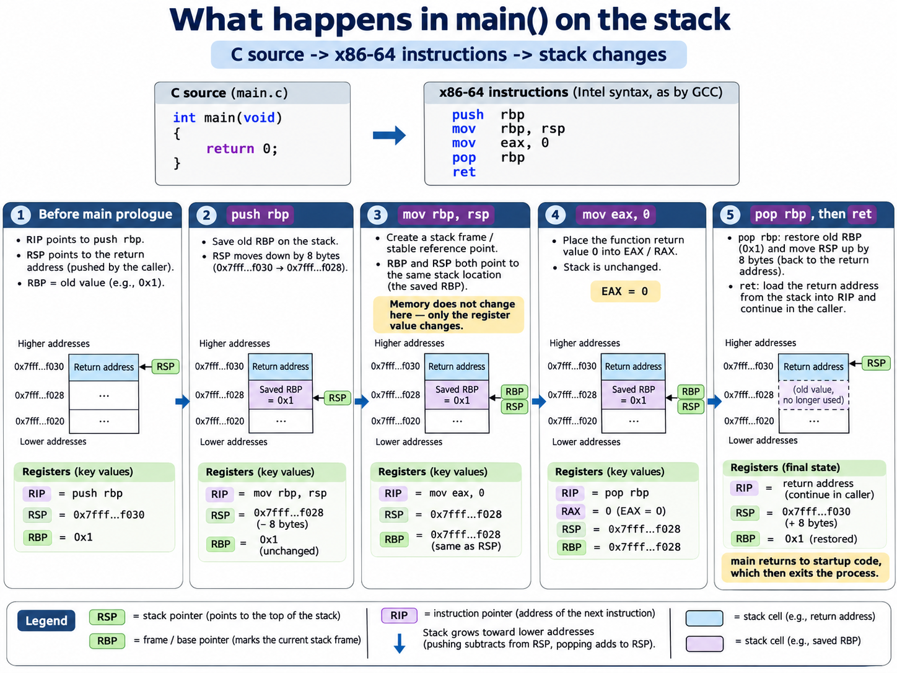
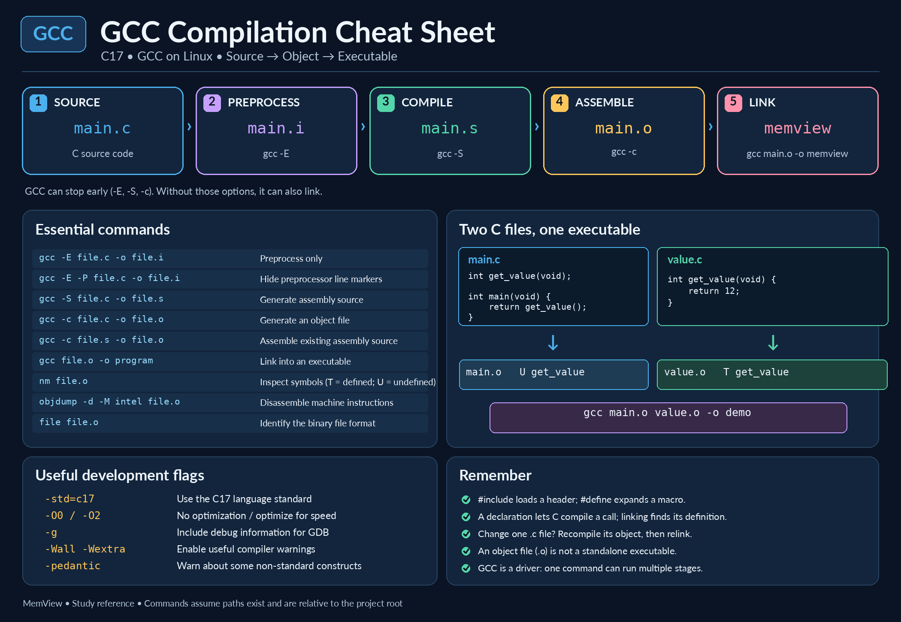

# 04 — Our First C Program: From Source Code to Machine Instructions

## Introduction

In this lesson, we will write, compile, execute, and debug our first C program.

The program will be intentionally simple. It will not print anything, read input, or perform calculations.

Instead, we will use it to understand what happens between writing C source code and executing machine instructions on the CPU.

Our goal is not just to make a program work. We want to understand **why it works and what the computer actually does**.

## What We Will Learn

By the end of this lesson, we should understand:

- The basic structure of a C program.
- The purpose of the `main()` function.
- How a program returns an exit status.
- The difference between source code, assembly code, object code, and an executable.
- How GCC transforms our source code into a program.
- The basic purpose of CPU registers.
- How the stack is used when calling and returning from functions.
- How to examine instructions, registers, and memory using GDB.

We will perform small experiments and compare our expectations with the actual results.

## 1. Our First Source File

Create a file named `src/main.c` in the project directory.

Enter the following program:

```c
int main(void)
{
    return 0;
}
```

This program contains only one function written by us: `main()`.

Let us examine its components:

- `int` specifies the function's return type. In this case, the function returns an integer.
- `main` is the designated entry function of a hosted C program.
- `(void)` explicitly indicates that the function accepts no parameters.
- `{` and `}` enclose the function body.
- `return 0;` ends the function and returns the integer value zero.

When used as the return value of `main()`, zero indicates successful program termination.

Although the program produces no visible output, it is a complete and valid C program.

## 2. Understanding the C Preprocessor

Before GCC translates C source code into assembly instructions, it performs a preprocessing step.

The preprocessor handles directives such as `#include`, `#define`, and conditional compilation.

It prepares the source code for the compiler but does not generate machine instructions.

### 2.1 Generating Preprocessed Source Code

Run the following commands from the project directory (create the build directory if it does not exist):

```bash
mkdir -p build/linux-native
gcc -std=c17 -E src/main.c -o build/linux-native/main.i
```

The `-E` option tells GCC to stop after preprocessing.

The `-o` option specifies the output file.

By convention, preprocessed C files commonly use the `.i` extension.

Open the result:

```bash
nano build/linux-native/main.i
```

You may notice additional lines beginning with `#` and containing filenames and line numbers.

These are line markers generated by the preprocessor. They help later compilation stages associate the processed text with its original source location.

For example, GCC may reference system headers such as `stdc-predef.h`, even when our program does not explicitly include any headers.

### 2.2 Removing Line Markers

To make the output easier to read, we can use the `-P` option:

```bash
gcc -std=c17 -E -P src/main.c -o build/linux-native/main-clean.i
```

The `-P` option suppresses the generation of line markers in the preprocessor output.

Our simple program contains no user-written preprocessing directives, so its executable C statements remain unchanged.

### 2.3 What Have We Learned?

Preprocessing is a separate stage of the C build process.

It can include headers, expand macros, and select parts of the source code through conditional compilation.

Understanding preprocessing helps us investigate compiler behavior and diagnose problems involving macros and header files.

**Important:** Preprocessing does not create an executable program. Additional compilation, assembling, and linking steps are still necessary.


## 3. Experiment: Header Files and Macros

Our first program has no user-written preprocessing directives. Let us give the preprocessor something to do without modifying `src/main.c`.

The following examples assume that we are working in the repository root on Linux. The `build/` directory is intentionally ignored by Git.

```bash
mkdir -p build/linux-native
nano build/linux-native/demo_values.h
```

Enter:

```c
#define RETURN_CODE 7
```

Now create `build/linux-native/demo.c`:

```c
#include "demo_values.h"

int main(void)
{
    return RETURN_CODE;
}
```

The quoted include tells the preprocessor to look for the header using the search rules for quoted headers. Here it is in the same directory as `demo.c`.

Run the preprocessor:

```bash
gcc -std=c17 -E -P build/linux-native/demo.c -o build/linux-native/demo.i
cat build/linux-native/demo.i
```

The meaningful part of the output is:

```c
int main(void)
{
    return 7;
}
```

**Two different operations took place:**

1. `#include` supplied the contents of the header.
2. `#define` introduced a macro; the preprocessor expanded `RETURN_CODE` into the preprocessing token `7`.

The header itself is not a separately compiled module. Also, `RETURN_CODE` is **not** a C variable. A declaration such as `const int number = 7;` has different semantics: it defines a C object whose use is processed by the compiler.

Now compile and run the experiment:

```bash
gcc -std=c17 -Wall -Wextra -pedantic build/linux-native/demo.c -o build/linux-native/demo
./build/linux-native/demo
echo $?
```

The shell should print `7`. This is the program's **exit status**, not text printed by the C program. On common Unix shells, `$?` refers to the most recently completed command.

**Try it:** Change the macro to `12`, rebuild, and check the exit status again. Next, replace `return RETURN_CODE;` with `return 12;`. With the same compilation settings, these simple forms lead to equivalent preprocessed C and normally identical assembly instructions.

**Important limitation:** Preprocessing operates on preprocessing tokens and directives. It does not execute ordinary C functions or evaluate C variables.

## 4. Compilation: From C to Assembly

The `-S` option asks GCC to stop after compilation and produce assembly text:

```bash
gcc -std=c17 -O0 -S src/main.c -o build/linux-native/main.s
nano build/linux-native/main.s
```

On our Debian x86-64 installation, GCC 14.2 with `-O0` generated the following important instructions (the full output also contained assembler directives and debugging-related metadata):

```asm
pushq %rbp
movq  %rsp, %rbp
movl  $0, %eax
popq  %rbp
ret
```

This is **AT&T syntax**. Registers are prefixed with `%`, immediate values with `$`, and for `mov` the source appears before the destination.

We can ask GCC for **Intel syntax** instead:

```bash
gcc -std=c17 -O0 -S -masm=intel src/main.c -o build/linux-native/main-intel.s
```

The corresponding instructions are:

```asm
push rbp
mov  rbp, rsp
mov  eax, 0
pop  rbp
ret
```

In Intel syntax, `mov destination, source` puts the destination first. The syntax differs, but both versions describe equivalent processor operations.

The function prologue and epilogue in this specific build:

- `push rbp` saves the caller's frame-pointer register on the stack.
- `mov rbp, rsp` establishes a frame-pointer reference for this function.
- `mov eax, 0` sets the integer return value.
- `pop rbp` restores the caller's frame-pointer register.
- `ret` returns control to the caller.

On the System V AMD64 calling convention used by our Debian build, a function returning `int` places its result in `EAX`. Writing to `EAX` also clears the upper half of `RAX` on x86-64.

**Do not memorize these five instructions as the universal translation of `main()`.** They were generated under particular compiler, target, and optimization settings. Optimized builds may omit the frame pointer or use fewer instructions. The C language defines program behavior, not this exact assembly sequence.

### 4.1 What Are All the Extra Lines?

An assembly listing may also contain `.globl`, `.type`, `.size`, `.section`, and `.cfi_*` directives.

These are **instructions to the assembler** or metadata directives, not necessarily CPU instructions. For example, the `.cfi_*` directives describe information used for stack unwinding and debugging.

### 4.2 How Long Is an Instruction?

Our debugger later showed these instruction boundaries:

| Address relative to `main` | Instruction | Length |
| --- | --- | ---: |
| `main+0` | `push rbp` | 1 byte |
| `main+1` | `mov rbp,rsp` | 3 bytes |
| `main+4` | `mov eax,0` | 5 bytes |
| `main+9` | `pop rbp` | 1 byte |
| `main+10` | `ret` | 1 byte |

This example occupies 11 bytes of machine instructions. x86-64 instructions are variable-length; the assembler and debugger must know where each instruction starts.

## 5. Assembling: From Assembly to Object Code

An assembly source file (`.s`) is still text. The CPU executes bytes representing machine instructions, not the characters `mov eax, 7`.

We can assemble our experimental `demo.c` as follows:

```bash
gcc -std=c17 -O0 -S build/linux-native/demo.c -o build/linux-native/demo.s
gcc -c build/linux-native/demo.s -o build/linux-native/demo.o
file build/linux-native/demo.o
```

The `-c` option stops before linking. On Linux x86-64, `file` should recognize the result as an **ELF 64-bit relocatable object**.

Inspect the machine instructions stored in the object file:

```bash
objdump -d -M intel build/linux-native/demo.o
```

For our `return 7;` experiment, the instruction can be encoded as:

```text
b8 07 00 00 00    mov eax,0x7
```

Here, `B8` is the opcode encoding for this form of the instruction; `07 00 00 00` is the four-byte immediate operand.

### 5.1 Little-Endian Byte Order

Our x86-64 system uses **little-endian** byte order for multi-byte integer values: the **least significant byte** is stored at the lowest address.

For the 32-bit value `0x12345678`, consecutive bytes at ascending addresses are:

```text
Address offset:    +0  +1  +2  +3
Bytes in memory:   78  56  34  12
```

It is the **order of whole bytes** that changes. We do not reverse the two hexadecimal digits *inside* each byte.

"Least significant" also does **not** mean "numerically smallest". Byte `0x78` is the least significant byte in the example even though its numeric value is greater than `0x12`.

## 6. Linking: From Object Files to an Executable

An object file already contains machine code, but it is not necessarily a complete executable. It may reference functions defined elsewhere and contain relocations that the linker must resolve.

First, we can link the object from the preceding experiment:

```bash
gcc build/linux-native/demo.o -o build/linux-native/demo-linked
file build/linux-native/demo-linked
./build/linux-native/demo-linked
echo $?
```

Expect the exit status `7`. On modern Debian, the linked result will commonly be reported as a **PIE executable**, whereas `demo.o` is a relocatable object.

### 6.1 One Program, Two Source Files

Create `build/linux-native/link_demo_main.c`:

```c
int get_value(void);

int main(void)
{
    return get_value();
}
```

The first line is a **function declaration**: it gives the compiler the interface of `get_value` but not its implementation.

Create `build/linux-native/link_demo_value.c`:

```c
int get_value(void)
{
    return 7;
}
```

This is the **function definition**. Now compile the files separately:

```bash
gcc -std=c17 -O0 -Wall -Wextra -pedantic -c build/linux-native/link_demo_main.c -o build/linux-native/link_demo_main.o
gcc -std=c17 -O0 -Wall -Wextra -pedantic -c build/linux-native/link_demo_value.c -o build/linux-native/link_demo_value.o
```

Inspect their symbols:

```bash
nm build/linux-native/link_demo_main.o
nm build/linux-native/link_demo_value.o
```

Typical relevant lines are:

```text
# link_demo_main.o
                 U get_value
0000000000000000 T main

# link_demo_value.o
0000000000000000 T get_value
```

The symbol type `U` means **undefined in this object**: the object needs a definition supplied elsewhere. `T` means the symbol is defined in the code (`text`) section.

Link both objects:

```bash
gcc build/linux-native/link_demo_main.o build/linux-native/link_demo_value.o -o build/linux-native/link_demo
./build/linux-native/link_demo
echo $?
```

The expected exit status is `7`.

If you omit the second object during linking:

```bash
gcc build/linux-native/link_demo_main.o -o build/linux-native/link_demo_incomplete
```

the linker should report an **undefined reference** to `get_value`. That is a linking error, not a syntax error in the C source.

### 6.2 Why Compile Files Separately?

Change the return value in `link_demo_value.c` to `12`, recompile **only** that source, then relink:

```bash
gcc -std=c17 -O0 -c build/linux-native/link_demo_value.c -o build/linux-native/link_demo_value.o
gcc build/linux-native/link_demo_main.o build/linux-native/link_demo_value.o -o build/linux-native/link_demo
./build/linux-native/link_demo
echo $?
```

The result becomes `12` without recompiling `link_demo_main.c`. This is the foundation of **incremental builds**.

A compiler needs appropriate declarations for functions used in the translation unit it is compiling. The linker needs definitions or supported dynamic references for the symbols left unresolved. Neither tool automatically searches the entire filesystem for every other `.c` file in our project.

GNU Make will automate the decision about which files need rebuilding. We develop that process step by step in [Lesson 05: GNU Make](05-gnu-make.md).

## 7. Debugging the Running Program with GDB

Until now we inspected files on disk. GDB allows us to inspect a **live process**: its registers, memory, call stack, and source-level variables.

Build our original `src/main.c` with debugging information:

```bash
gcc -std=c17 -O0 -g -fno-omit-frame-pointer -Wall -Wextra -pedantic src/main.c -o build/linux-native/memview
gdb ./build/linux-native/memview
```

Inside GDB, enter **each command separately**, pressing Enter after each:

```gdb
set disassembly-flavor intel
break *main
run
x/5i $rip
info registers rip rsp rbp rax
```

- `set disassembly-flavor intel` selects Intel assembly notation.
- `break *main` sets a breakpoint at the beginning of the machine code for `main`, before its first instruction.
- `run` starts the process.
- `x/5i $rip` examines five instructions starting at the current instruction pointer.
- `info registers` prints the requested processor registers.

Without `run` (or another operation that starts or attaches to a process), GDB may report `No registers` because there is no active inferior process.

### 7.1 Understanding the Registers

| Register | Purpose in this experiment |
| --- | --- |
| `RIP` | Address of the next instruction to execute |
| `RSP` | Stack pointer: address of the current top of the stack |
| `RBP` | Frame-pointer register when this calling convention/compiler uses it |
| `RAX / EAX` | Register used for our integer function return value |

The stack is memory belonging to the process. The register `RSP` contains an address **into** that memory; it is not the memory contents themselves.

A call instruction commonly puts a **return address** onto the stack. When `main` executes `ret`, that address tells the processor where to continue in the C runtime startup code. Returning from `main` is not identical to returning to the shell: the runtime finishes terminating the process, after which the shell can continue.

### 7.2 A Real Instruction-by-Instruction Observation

On our native Debian x86-64 experiment, GDB showed:

```text
=> 0x555555555129 <main>:     push rbp
   0x55555555512a <main+1>:   mov  rbp,rsp
   0x55555555512d <main+4>:   mov  eax,0x0
   0x555555555132 <main+9>:   pop  rbp
   0x555555555133 <main+10>:  ret
```

Before the first instruction, the registers included:

```text
RIP = 0x555555555129
RSP = 0x7fffffffd848
RBP = 0x1
```

These are **observed values**, not constants required by C. Addresses may change between runs due to address-space layout randomization (ASLR). The original `RBP` value is also an incidental value inherited from the caller, not something `main` may generally rely upon.

Execute `push rbp`:

```gdb
si
info registers rip rsp rbp
```

The observed stack pointer became `0x7fffffffd840`, eight bytes lower. `RBP` still contained `0x1`.

Execute `mov rbp,rsp`:

```gdb
si
info registers rip rsp rbp
x/2gx $rsp
```

Now both `RSP` and `RBP` were `0x7fffffffd840`. GDB displayed:

```text
0x7fffffffd840:  0x0000000000000001  0x00007ffff7dd1ca8
```

At `0x7fffffffd840` lies the saved original `RBP`. At the next higher eight-byte address, `0x7fffffffd848`, lies the return address.

The distinction matters:

```gdb
p/x $rbp
x/gx $rbp
```

The first command prints the **value in RBP** (an address in this example). The second examines the **eight bytes of memory at that address**.

Execute `mov eax,0` and then `pop rbp`:

```gdb
si
si
info registers rip rsp rbp rax
x/gx $rsp
```

The observed values were:

```text
RIP = 0x555555555133   # points to ret
RSP = 0x7fffffffd848
RBP = 0x1
RAX = 0x0
```

The stack pointer again points to the return address. `pop` restored `RBP` but did not have to erase the old bytes from memory.

Finally execute `ret`:

```gdb
si
info registers rip rsp rbp rax
continue
```

The recorded values immediately after `ret` were:

```text
RIP = 0x7ffff7dd1ca8   # inside __libc_start_call_main
RSP = 0x7fffffffd850
RBP = 0x1
RAX = 0x0
```

The process then reported a normal exit. The `ret` instruction had loaded the return address into `RIP` and increased `RSP` by eight bytes.



*Figure: A visual summary of the stack-frame setup and teardown. The specific register values in our experiment are examples; the mechanism is the lesson.*

### 7.3 Useful GDB Commands Beyond Assembly

We used `si` ("step instruction") to understand machine-level behavior. Ordinary C debugging is much more convenient at the source level.

| GDB command | Typical purpose |
| --- | --- |
| `break main` | Break at a source-level location in `main` |
| `break main.c:10` | Break at a specified source line if available |
| `run` | Start/restart the debugged program |
| `next` | Advance a source line, stepping over calls |
| `step` | Advance a source line, potentially stepping into a call |
| `print variable` | Inspect a C expression or variable |
| `watch variable` | Stop when a watchable expression changes |
| `backtrace` | Show the current call stack |
| `x/16xb address` | Display 16 memory bytes in hexadecimal |
| `x/5i $rip` | Disassemble five instructions |
| `continue` | Resume running until the next stop |
| `quit` | Leave GDB |

A message such as `../sysdeps/nptl/libc_start_call_main.h: No such file or directory` usually means GDB does not have access to the **glibc source file** for that source location. It is not evidence that our executable failed.

## 8. GCC Quick Reference



*Figure: GCC compilation reference. The text commands below are the authoritative, copyable examples for this lesson.*

| Option | Meaning |
| --- | --- |
| `-std=c17` | Select the C17 language mode |
| `-E` | Stop after preprocessing |
| `-P` | Suppress line markers in preprocessor output |
| `-S` | Stop after producing assembly text |
| `-c` | Compile/assemble to an object file without linking |
| `-o FILE` | Specify an output filename |
| `-g` | Generate debugging information |
| `-O0` | Disable normal optimizations |
| `-O2` | Enable a commonly used optimization level |
| `-Wall` / `-Wextra` | Enable groups of useful warnings |
| `-pedantic` | Diagnose certain nonconforming constructs |
| `-fno-omit-frame-pointer` | Request retention of frame pointers |
| `-masm=intel` | Request Intel-style assembly output on x86 targets |

A useful mental model:

```text
main.c  --preprocessor--> main.i
main.i  --compiler------> main.s
main.s  --assembler-----> main.o
main.o  --linker--------> executable
```

GCC is a **driver** that orchestrates these stages. Options such as `-E`, `-S`, and `-c` allow us to stop at different points in the pipeline.

## 9. What We Have Learned

We began with four lines of C and examined several layers of their implementation:

1. **Preprocessing:** headers, macro expansion, and line markers.
2. **Compilation:** C statements represented as assembly instructions.
3. **Assembling:** assembly text encoded as machine instructions inside an object file.
4. **Linking:** object files and symbol references combined into an executable.
5. **Execution and debugging:** a running process with registers, memory, and return addresses.

The crucial distinctions are **source text versus executable instructions**, **an address versus the contents stored at that address**, and **what C guarantees versus what one compiler happens to generate**.

For the next lesson, we will automate the two-file build using [GNU Make](05-gnu-make.md), starting with completely explicit commands and introducing each abbreviation only after we understand what it replaces.
