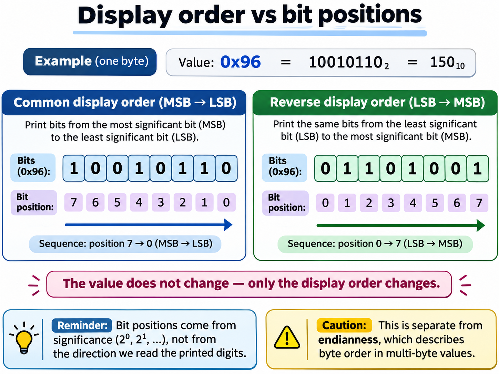
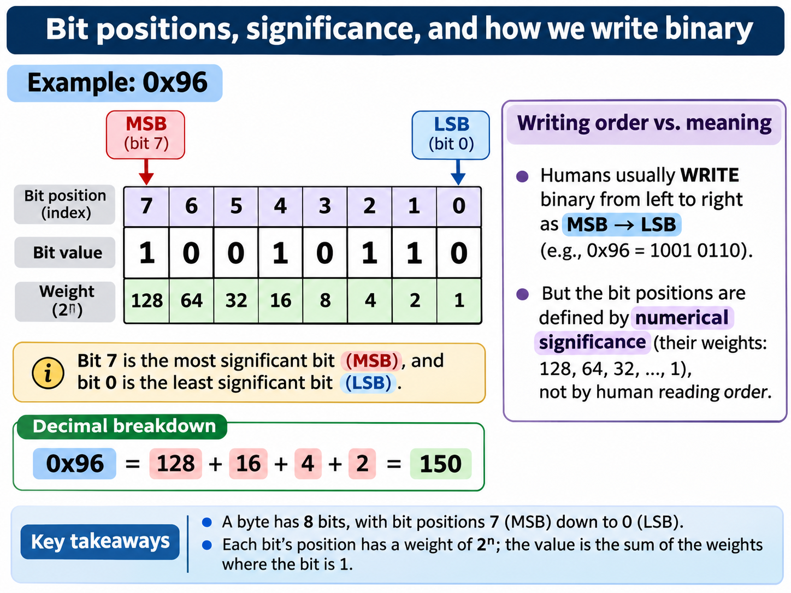

# Lesson 11: Loops in C and Our First Binary Display

> **Starting point:** This chapter follows our completed bit helpers and their automated tests. If you already know loops from C#, focus on C's type rules, integer promotions, the unsigned countdown trap, and integrating the loop with our `check_bit()` function.

## Learning objectives

By the end of the chapter, you should be able to:

- Explain the difference between iteration and repetition written out manually.
- Use `while`, `do ... while`, and `for` loops in C17.
- Distinguish the three clauses of a `for` loop.
- Use `break` and `continue` deliberately.
- Recognize off-by-one errors and infinite loops.
- Understand why counting backwards with an `unsigned` variable needs care.
- Display every bit of an `unsigned char` using our reusable `check_bit()` helper.
- Rebuild and test the program using the project's existing Makefile.

We assume that the project already contains `include/helpers.h`, `src/helpers.c`, and a `Makefile` that builds them. Review [Lesson 07](07-bitwise-operations-and-masks.md) for bit masks, [Lesson 08](08-modules-headers-and-separate-compilation.md) for functions and headers, and [Lesson 10](10-first-automated-c-tests.md) for tests.

## 1. Why loops exist

Suppose we want to print the numbers one through four:

```c
printf("%d\n", 1);
printf("%d\n", 2);
printf("%d\n", 3);
printf("%d\n", 4);
```

That works, but it repeats the same operation with slightly different inputs. If we want to do this one thousand times, manually repeating the statement is neither convenient nor maintainable.

A **loop** executes an operation repeatedly under some condition. The program must also have a way to *stop* repeating.

We will learn three important loop forms and then use them to display all the bits of a byte.

## 2. `while`: check first, then execute

The basic form is:

```c
while (condition)
{
    /* Repeated statements */
}
```

For example:

```c
#include <stdio.h>

int main(void)
{
    unsigned int number = 1u;

    while (number <= 4u)
    {
        printf("%u\n", number);
        ++number;
    }

    return 0;
}
```

Trace it on paper:

| Before iteration | Condition `number <= 4u` | Printed | Value afterward |
| ---: | --- | ---: | ---: |
| 1 | True | 1 | 2 |
| 2 | True | 2 | 3 |
| 3 | True | 3 | 4 |
| 4 | True | 4 | 5 |
| 5 | False | Nothing | Loop ends |

Expected output:

```text
1
2
3
4
```

A `while` loop can execute **zero times** if its condition is false at the first check.

### A common mistake: forgetting to make progress

```c
unsigned int number = 1u;

while (number <= 4u)
{
    printf("%u\n", number);
    /* Missing ++number; */
}
```

The condition stays true forever unless something else changes `number` or the program is interrupted.

A useful question when reviewing a loop is:

> What changes during each iteration, and how can the loop eventually terminate?

## 3. `do ... while`: execute first, check afterward

The basic form is:

```c
do
{
    /* Repeated statements */
} while (condition);
```

The semicolon after `while (condition)` is **required** here.

Example:

```c
#include <stdio.h>

int main(void)
{
    unsigned int number = 1u;

    do
    {
        printf("%u\n", number);
        ++number;
    } while (number <= 4u);

    return 0;
}
```

This also prints one through four, but there is one crucial difference: the body runs **at least once**, even if the condition is initially false.

Try starting with `number = 9u`. A `while (number <= 4u)` loop would print nothing, but a `do ... while` would print `9` before checking the condition.

This form is useful when an operation must be performed once before we can decide whether to repeat it—for example, reading a choice and then asking whether to continue.

## 4. `for`: place the loop's control in one line

A `for` loop combines three parts:

```c
for (initialization; condition; update)
{
    /* Repeated statements */
}
```

For example:

```c
#include <stdio.h>

int main(void)
{
    for (unsigned int number = 1u; number <= 4u; ++number)
    {
        printf("%u\n", number);
    }

    return 0;
}
```

Here:

1. `unsigned int number = 1u` initializes the counter **once**.
2. `number <= 4u` is checked **before each iteration**.
3. `++number` executes after an ordinary iteration, before checking the condition again.

In C17, a variable declared in the initialization clause belongs to the scope of the `for` loop and its body. It is not available after the loop ends.

The `for` and `while` forms can often express the same algorithm:

```c
/* for */
for (unsigned int i = 0u; i < 4u; ++i)
{
    printf("%u\n", i);
}

/* equivalent progression with while */
unsigned int i = 0u;
while (i < 4u)
{
    printf("%u\n", i);
    ++i;
}
```

In a C# background, the syntax will look familiar. The important differences arise when integer types and boundary conditions are involved.

### 4.1 Why start counting at zero?

In C, array indexing starts at zero. Many loop conditions therefore take the shape:

```c
for (unsigned int i = 0u; i < count; ++i)
{
    /* Use item i */
}
```

If `count` is four, the visited indices are `0, 1, 2, 3`.

Writing `i <= count` instead would visit `4` as well. That is one iteration too many if we intend to index a four-element array. Accessing outside a real array's bounds is a serious bug; we will revisit this when we learn arrays.

## 5. `break` and `continue`

These two keywords change the normal control flow.

### `break`: exit the nearest loop

```c
for (unsigned int i = 0u; i < 10u; ++i)
{
    if (i == 3u)
    {
        break;
    }

    printf("%u ", i);
}
```

Output:

```text
0 1 2
```

The loop ends when `i` reaches three.

### `continue`: skip to the next iteration

```c
for (unsigned int i = 0u; i < 5u; ++i)
{
    if (i == 2u)
    {
        continue;
    }

    printf("%u ", i);
}
```

Output:

```text
0 1 3 4
```

In a `for` loop, `continue` proceeds to the **update clause** and then the next condition check.

In a `while` loop, `continue` jumps to the condition check. If the update of a counter is accidentally skipped, the loop may stop making progress and run forever.

**Compare with `return`:** `break` exits a loop; `return` exits the current function.

## 6. Types matter: signed versus unsigned

We already learned about unsigned wraparound in [Lesson 06](06-c-integer-types.md).

An unsigned integer does not represent negative values. For an ordinary 32-bit `unsigned int`:

```text
0 - 1 -> 4294967295
```

The general rule is arithmetic modulo `UINT_MAX + 1`. The exact maximum depends on the implementation; inspect `UINT_MAX` from `<limits.h>`.

### 6.1 The dangerous reverse loop

The following code is **WRONG**:

```c
/* WRONG: Do not run this as a normal exercise. */
for (unsigned int position = 7u; position >= 0u; --position)
{
    printf("%u\n", position);
}
```

Why?

- The condition `position >= 0u` is always true for an `unsigned int`.
- When `position` is zero, `--position` wraps to `UINT_MAX`.
- The loop does not terminate naturally.

This is not a signed-overflow bug; unsigned wraparound is **defined C behavior**, but our loop condition is wrong.

If we used this counter as a bit position, we might also pass an invalid large position to our helper. Our helper protects against invalid positions, but that still would not make the loop terminate.

### 6.2 One solution: use a signed counter

For eight-bit examples:

```c
for (int position = 7; position >= 0; --position)
{
    printf("%d", check_bit(0xA5u, (unsigned int)position));
}
```

This works: after zero, `position` becomes negative one and the condition becomes false.

However, converting between signed and unsigned indices at function boundaries is something we should think about deliberately.

### 6.3 An alternative: count **remaining positions** down to zero

We can stay with an unsigned counter and avoid underflow:

```c
for (unsigned int remaining = 8u; remaining > 0u; --remaining)
{
    unsigned int position = remaining - 1u;
    printf("%d", check_bit(0xA5u, position));
}
```

Trace:

| Remaining | Position used | Next remaining |
| ---: | ---: | ---: |
| 8 | 7 | 7 |
| 7 | 6 | 6 |
| 6 | 5 | 5 |
| ... | ... | ... |
| 1 | 0 | 0 |
| 0 | Loop ends | Not executed |

Notice that we compute `remaining - 1u` **only when remaining is greater than zero**. No unsigned underflow is needed.

That is the strategy we will use for our binary display.

### 6.4 Bit positions are about **significance**, not the direction of reading

Before we use a loop to print a byte, let us clarify one easily misunderstood point. **Bit positions are numbered by their mathematical weight.** The least significant bit is position 0, with weight 2^0 = 1. Position 1 has weight 2^1 = 2, and so on.

On the eight-bit-byte computers used for our exercises, the value `0x96` can be written as:

```text
Position:       7   6   5   4   3   2   1   0
Bit:            1   0   0   1   0   1   1   0
Weight:       128  64  32  16   8   4   2   1

0x96 = 128 + 16 + 4 + 2 = 150
```



**MSB** means *most significant bit*, here position 7. **LSB** means *least significant bit*, here position 0.

When we write a binary number in the usual human-readable form, we put the most significant digit on the left:

```text
0x96 = 10010110 (binary)
```

However, that familiar printed direction is **not a claim about where individual bits physically sit inside hardware**. C bitwise operators are defined in terms of the integer value and its bit positions. We are selecting and testing a bit by its numerical significance.

Also remember that a C byte is `CHAR_BIT` bits; although it is eight bits on our Debian system, the C language does not require `CHAR_BIT` to equal eight on every possible implementation.

### 6.5 Two display orders, **one unchanged value**

Our helper `check_bit(value, position)` checks whichever position we request. It does not automatically read from right to left or left to right. **The loop chooses the order.**

To make the difference visible, use `0x96` instead of `0xA5`. The latter is a palindrome in binary (`10100101`) and looks the same in either display order, which would hide the difference.



If we visit positions **7, 6, 5, ..., 0**, our printed digits are:

```text
Position: 7 6 5 4 3 2 1 0
Bit:      1 0 0 1 0 1 1 0
Output:   10010110
```

If we visit positions **0, 1, 2, ..., 7**, our printed digits are:

```text
Position: 0 1 2 3 4 5 6 7
Bit:      0 1 1 0 1 0 0 1
Output:   01101001
```

The **stored integer value remains 0x96** in both cases. The second row is a reversed *display sequence*, not a claim that the integer has changed to the conventional binary number `01101001`.

We can demonstrate the ascending order using a simple loop:

```c
unsigned char value = 0x96u;

for (unsigned int position = 0u;
     position < (unsigned int)CHAR_BIT;
     ++position)
{
    printf("%d", check_bit(value, position));
}
putchar('\n');
```

On our Debian system this prints `01101001`. The descending loop in the following section prints `10010110`.

**Do not confuse bit display order with endianness.** Endianness normally describes the arrangement of **bytes** within a multi-byte object in memory. For example, the number `0x12345678` can be represented as bytes `78 56 34 12` in little-endian order, or `12 34 56 78` in big-endian order. Neither byte order determines which bit position our `check_bit()` function tests first.

> **A useful summary:** Bits have numerical weights; bytes have addresses; a viewer chooses how to display them.

---

## 7. Our first binary viewer: use the helpers we wrote

A byte is represented by `CHAR_BIT` bits, where `CHAR_BIT` is defined in `<limits.h>`. On our Debian x86-64 environment, `CHAR_BIT` is eight.

We want to display the **most significant bit first**, so that the result looks like the familiar binary notation.

Temporarily replace `src/main.c` with:

```c
#include <limits.h>
#include <stdio.h>

#include "helpers.h"

int main(void)
{
    unsigned char value = 0xA5u;

    printf("Hex: 0x%02X\n", (unsigned int)value);
    printf("Binary: ");

    for (unsigned int remaining = (unsigned int)CHAR_BIT;
         remaining > 0u;
         --remaining)
    {
        unsigned int position = remaining - 1u;
        printf("%d", check_bit(value, position));
    }

    putchar('\n');

    return 0;
}
```

Build and run using our existing Makefile:

```bash
make
./build/memview
```

Expected on our eight-bit-byte Debian system:

```text
Hex: 0xA5
Binary: 10100101
```

### 7.1 Why the output is in the expected order

For `0xA5`, our helper reads bits in this sequence:

```text
Position:  7 6 5 4 3 2 1 0
Bit:       1 0 1 0 0 1 0 1
Printed:   10100101
```

We have reused the function:

```c
int check_bit(unsigned char value, unsigned int position);
```

There is no need to duplicate the mask expression inside `main.c`.

This is our first tiny step toward the output component of MemView.

### 7.2 Why `putchar('\n')`?

Our loop prints one digit at a time, with no newline. After the loop finishes, `putchar('\n')` prints a newline character.

`putchar` comes from `<stdio.h>`. We will study input/output in more depth later.

### 7.3 Is this yet a real memory viewer?

Not yet. We are formatting one **value** already present in a variable. We are not reading arbitrary process memory or examining memory addresses.

That is a deliberate boundary. Before building a real viewer, we need to understand arrays, addresses, pointers, bounds, and how operating systems protect memory.

## 8. Small experiments

Try changing only this line:

```c
unsigned char value = 0xA5u;
```

Predict the output before rebuilding:

- `0x00u` -> all bits zero.
- `0xFFu` -> all bits one on our eight-bit-byte system.
- `0x81u` -> first and last bits one.
- `0x0Fu` -> four leading zeros followed by four ones.

Keep the leading zeros: **eight printed digits** are important when displaying a byte.

### Bonus: insert visual groups

For a human-readable display, we might later print a space after every four bits:

```text
1010 0101
```

But do not rush into more conditions yet. First make sure the straightforward eight-bit output is clear.

## 9. A first thought about testing loops

A human can easily inspect eight bits, but our larger project will need automated tests for formatting too.

It might be tempting to put `printf` inside our `helpers.c` module and use it to display bits. That would make the helper module responsible for both **bit operations** and **presentation**.

Instead, later we can create a separate formatting function, for example one that writes characters to a caller-provided buffer. We will need arrays and pointers to do that safely, so we will wait until those topics are understood.

For now:

- `helpers.c` performs reusable bit calculations.
- `main.c` controls the demonstration and prints the result.
- `tests/test_helpers.c` checks the helper calculations.
- The Makefile compiles and links the project.

This preserves our separation of responsibilities.

## 10. Exercises and review questions

1. What is the main difference between `while` and `do ... while`?
2. Which part of a `for` loop executes only once?
3. Why does `i < count` usually work better than `i <= count` when indexing `count` elements?
4. What does `continue` do in a `for` loop?
5. Why is `unsigned int position >= 0u` always true?
6. Why is `remaining - 1u` safe **inside** our loop body?
7. Why do we visit bit positions from `CHAR_BIT - 1` down to zero?
8. What would be different if we counted positions upward from zero?
9. Why do we keep the bit-reading logic in `helpers.c` instead of repeating bit masks in `main.c`?

### Recap

Loops allow us to express repetitive work without duplicating statements. The syntax of C's loops is familiar to many C-family programmers, but **type rules and loop boundaries are vital**. For MemView, the safest habit is to understand the range of the counter before writing the termination condition.

The next stages can cover arrays, buffers, and eventually formatting multiple bytes into a proper hex dump.
